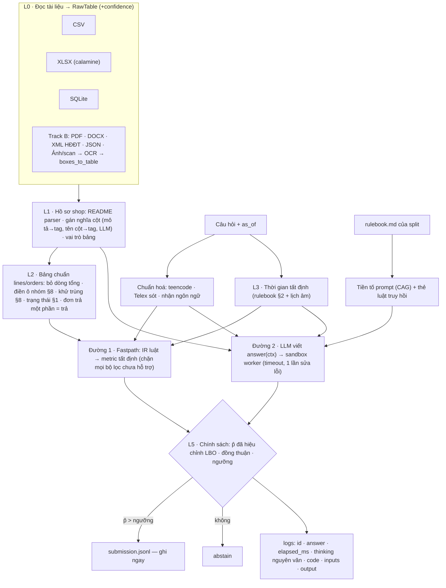

# SổCái — Agent hỏi đáp sổ sách cho doanh nghiệp nhỏ Việt Nam

> **Cập nhật 10/11:** đo thật trên laptop cho thấy Qwen3-4B tự viết code đạt 0/23, nhưng làm bộ phân loại câu hỏi thì đúng 17/20, chỉ ~1 giây/câu. Hướng "dùng ít tài nguyên" được đề xuất trong [thiet-ke-gon.md](thiet-ke-gon.md), đang chờ góp ý.

> Bài toán gốc: **Zalo AI Challenge 2026 · DataMate**: trả lời câu hỏi tiếng Việt đời thường trên dữ liệu bảng bẩn (CSV/XLSX/SQLite), chấm bằng Penalized Accuracy.
> Hai tầng mục tiêu:
> - **Track A**: bài thi, có hạn cứng.
> - **Track B**: nền tảng mở rộng cho doanh nghiệp Việt Nam (đa ngôn ngữ, giấy tờ/ảnh chụp, tình huống nghiệp vụ). Track B được thiết kế để code chạm tới ngay, nhưng **không được làm chậm Track A**.
>
> Cập nhật: 10/11/2026.
>
> Nhãn evidence:
> - **[ĐCBC]** Đã có bằng chứng (đo trên dữ liệu thật trong repo này)
> - **[GĐ]** Giả định
> - **[SL]** Suy luận
> - **[CB]** Chưa biết
> - **[CKC]** Cần kiểm chứng

---

## 0. Tóm tắt

| | |
|---|---|
| **Bài toán** | Chủ shop có dữ liệu nhưng không viết được truy vấn. Agent nhận gói dữ liệu của một shop, `rulebook.md`, lịch âm và một câu hỏi tiếng Việt (có thể không dấu, teencode, gõ sai). Đầu ra là một đáp án đúng format, hoặc `unanswerable`, hoặc bỏ trống |
| **Điều thực sự được chấm** | Đúng +1, **sai −1**, bỏ trống 0. Vì vậy chỉ nên trả lời khi P(đúng) > 0,5. Đây là bài toán **trả lời có chọn lọc** (selective answering), không phải chỉ là text-to-SQL |
| **Ý tưởng cốt lõi** | (1) Tất định ở mọi chỗ có thể: đọc ô bẩn, giải thời gian, luật doanh thu. (2) LLM viết code trên bảng thô cho phần đuôi dài. (3) Chính sách trả lời theo xác suất đúng đã hiệu chỉnh leave-business-out. (4) Không bao giờ "bỏ qua lặng lẽ": ô không đọc được thì **từ chối**, không cộng thiếu |
| **Bằng chứng hiện có** | Chỉ riêng đường luật, không LLM: **PA = +0,295 trên 3.000 câu train** (939 đúng, 54 sai, 2.007 bỏ trống), precision 94,6%. Ba lỗi dữ liệu gốc được tìm và sửa nhờ đo lường **[ĐCBC]**. Đường LLM đã chạy đầu cuối với LLM giả; **chưa đo với mô hình thật** **[CB]** |
| **Mở rộng** | Bộ đọc PDF/DOCX/XML hoá đơn điện tử/JSON/ảnh (OCR) cùng một giao diện `RawTable` + `confidence`; câu hỏi đa ngữ ra cùng một IR; thế giới dữ liệu tổng hợp có đáp án chính xác để test |

---

## 1. Đề bài sinh ra những ràng buộc thiết kế nào

| Ràng buộc (nguồn) | Hệ quả thiết kế |
|---|---|
| PA: sai = −1, bỏ trống = 0 | Trả lời ⇔ P̂(đúng) > ngưỡng. Cần **ước lượng P(đúng) đã hiệu chỉnh**, không chỉ một đáp án |
| `unanswerable` đúng chỉ khi đáp án chuẩn là `unanswerable`; trả giá trị cho câu không trả lời được là sai | Kiểm phủ dữ liệu tất định theo §7 ("kỳ nằm hoàn toàn ngoài khoảng dữ liệu → không trả lời được, không phải 0") |
| Rulebook **riêng từng split**, phải đọc rulebook của split đang chạy | Rulebook là **dữ liệu**: toàn văn nằm trong tiền tố prompt (CAG), thẻ luật được truy hồi. Thư viện metric chỉ mã hoá luật ổn định và có tham chiếu § |
| Private có **ngành chưa xuất hiện** | Không thể chỉ dựa vào schema chuẩn và lexicon. Bắt buộc có đường **LLM viết code trên bảng thô** |
| ≤ 15B tham số **tổng mọi mô hình** (kể cả embedding, reranker, OCR) | Một LLM ~14B gần như dùng hết ngân sách → không dùng embedding/reranker; truy hồi bằng từ khoá. OCR **không** được đưa vào image thi |
| Offline, `--network none`, `/data` chỉ đọc | vLLM chạy cục bộ; cache ghi `/tmp` |
| 6 giờ, kể cả nạp mô hình; quá giờ thì câu chưa ghi = bỏ trống | Ghi từng câu ngay lập tức; ngân sách thời gian toàn cục; hết giờ thì chỉ chạy đường nhanh |
| \|PA(nộp) − PA(BTC chạy lại)\| ≤ 0,03, nếu không giải thích được thì bị loại | Greedy + seed; không batching song song; thứ tự cố định; log đủ `thinking` nguyên văn |
| Cấm logic theo id câu/shop; cấm huấn luyện trên public/private | Lexicon và hiệu chỉnh **chỉ từ train**; ánh xạ cột sinh lúc chạy, không dựng sẵn cho shop public |

---

## 2. Dữ liệu thực tế trông như thế nào **[ĐCBC]**

**Quy mô:**
- **Train:** 30 shop, 3.000 câu có đáp án.
- **Public:** 14 shop, 1.000 câu.
- Mỗi shop có 12–30 tháng dữ liệu, từ vài trăm đến khoảng 170.000 dòng.

**Phân bố type đáp án (train):**

| type | number | percent | list | date | string | unanswerable | boolean | table |
|---|---|---|---|---|---|---|---|---|
| Số câu | 1.884 | 578 | 193 | 145 | 88 | 70 | 23 | 19 |

**Các kiểu "bẩn" gặp thật:**

| Kiểu | Ví dụ thật |
|---|---|
| Tiền | `86k`, `53.500đ`, `22,000`, `2,760,000.0000`, `9.656.666đ`, **`1,156tr`**, **`1tr590`** |
| Ngày | serial Excel `45717`, `01/02/2026`, `1 thg 7 2025`, `28/4` (năm lấy theo tên sheet) |
| Số lượng | `5 chai`, `1 hộp` |
| Bố cục | Dòng tiêu đề báo cáo trên header; header hai tầng; mỗi tháng một sheet; **dòng tổng chèn giữa sổ** ("TỔNG NGÀY 09/04", "Tổng tháng 4/2026"); ô trống theo nhóm đơn (§8) |
| Trạng thái đơn | 30+ cách viết: "đã xong", "đã lấy", "ok", "completed", "huỷ đơn", "khách huỷ", "không giao được", "hàng trả về"… |
| Đặt tên cột | 578 tên cột khác nhau |

**Tín hiệu README:**
- 37/44 README có mục "Cột trong …".
- Mô tả cột là **từ vựng có kiểm soát** (193 cụm; "thành tiền sau giảm" xuất hiện 37 lần), nên ánh xạ theo mô tả bền hơn ánh xạ theo tên cột.

**Độ phủ của lexicon (dựng chỉ từ train):**
- 24/30 shop train được gán nghĩa gần đủ.
- SQLite, nguồn hỗn hợp và **cả 4 ngành mới của public** (điện thoại, sửa xe, mẹ và bé ×2) có **0 bảng được nhận vai trò**.
- Đây là ước lượng gần nhất cho private, vì private có thêm ngành chưa thấy **[SL]**.

**Rulebook train → public:**
- Train có 70 thẻ luật, public có 92: **thêm 25, bỏ 3, sửa 3**.
- Có 3 ngành mới; luật mới như "khách sộp nhất" và "giờ cao điểm".
- Luật bị bỏ ở public: "giá bán X ngày D", "tồn theo đơn vị lớn", "giá nhập bình quân". Nếu agent lặng lẽ áp luật train cho câu public thì sai **[ĐCBC]** (`socai rulebook-diff`).

**Câu hỏi:**
- Teencode ("dthu", "bnhiu", "z"), không dấu, **gõ Telex sót** ("nhoms", "trowr leen", "tawng/giamr", "luwowtj").
- Tham chiếu tương đối ("tuần rồi", "2/26", "th 6/26", "cùng kỳ năm trước", "từ đầu tháng này đến hết bữa nay").

---

## 3. Bốn nguyên tắc thiết kế

### P1. Trả lời theo kỳ vọng điểm
Kỳ vọng điểm khi trả lời là `2p − 1`, khi bỏ trống là `0`. Vì vậy chỉ trả lời khi `p > 0,5`.

**Cách ước lượng p:**
- p của một ứng viên là precision đo được của cặp (nguồn, metric) trên train, theo **leave-business-out**: shop X chỉ dùng thống kê từ 29 shop còn lại.
- Hai đường độc lập ra **cùng đáp án** thì p tăng; khác nhau thì p bị chặn trên.
- Nguồn trích xuất (OCR) nhân thêm `confidence` < 1.

**Ngưỡng:** mặc định 0,6, không phải 0,5. Hiệu chỉnh trên train lạc quan hơn private, vì private có ngành mới **[SL]**.

### P2. LLM không tự tính ngày, không tự đọc tiền
Giải "tuần rồi / tháng này so với tháng trước / Tết 2025" là **code tất định** theo §2 (`rules/timeexpr.py`): tuần bắt đầu thứ Hai, "tháng này so với tháng trước" lấy cùng số ngày, Tết lấy từ `calendar.csv`.

Đọc `1tr590` cũng là code tất định (`io/cells.py`). LLM nhận **các ngày đã giải sẵn** trong prompt và gọi `ctx.period()`, `num()`, `day()`. Lý do: đây là các chỗ LLM nhỏ hay sai lặng lẽ, trong khi code đúng thì luôn đúng.

### P3. Rulebook là dữ liệu, không phải code
- Toàn văn rulebook của split nằm ở **tiền tố prompt**: giống nhau cho mọi câu, nên được vLLM prefix-cache (đây là CAG).
- Thẻ luật liên quan được truy hồi bằng trùng từ và nhắc lại cạnh câu hỏi.
- Thư viện metric chỉ mã hoá luật **ổn định giữa hai split** (định nghĩa doanh thu §1, tuần, làm tròn), và mỗi hàm ghi rõ §.
- Mỗi lần có rulebook mới, chạy `rulebook-diff` để biết luật nào trong code có thể đã lỗi thời.

### P4. Không bao giờ bỏ qua lặng lẽ
Cả ba lỗi dữ liệu lớn nhất tìm được đều cùng một dạng: **dữ liệu không đọc được nhưng phép tính vẫn ra số**.
- `1,156tr` bị đọc thành 1,156 tỷ.
- `1tr590` thành NaN rồi bị bỏ khi cộng.
- Dòng "TỔNG NGÀY" bị gán vào đơn trước.

Quy tắc rút ra: ô tiền không đọc được trong kỳ hỏi ⇒ metric **từ chối** (`Unsupported`) ⇒ chuyển đường khác hoặc bỏ trống. Có test hồi quy cho cả ba lỗi (`tests/test_real_data.py`).

---

## 4. Kiến trúc

| Tầng | File | Trạng thái |
|---|---|---|
| L0 đọc CSV/XLSX/SQLite, phát hiện header, gộp sheet theo tháng | `io/readers.py`, `io/cells.py` | Chạy trên 44/44 shop **[ĐCBC]** |
| L0 mở rộng: PDF, DOCX, XML, JSON, ảnh → OCR | `io/docs.py` | XML, JSON, `boxes_to_table` có test; PDF/DOCX cần thư viện tuỳ chọn; **chưa gắn OCR engine** |
| L1 README, lexicon, vai trò bảng | `profile/*.py`, `semantic/lexicon.py` | Chạy; gán nghĩa bằng LLM **chưa làm** |
| L2 bảng chuẩn | `semantic/canonical.py` | Chạy cho mẫu "dòng hàng/đơn"; chưa có công nợ, kho, lô, nhập |
| L3 thời gian, lịch âm, rulebook | `rules/*.py` | Chạy, có test |
| Đường 1 fastpath + metric | `nlq/fastpath.py`, `exec/metrics.py` | 8 ý định; precision 94,6% trên train **[ĐCBC]** |
| Đường 2 LLM → code → sandbox | `nlq/prompts.py`, `exec/api.py`, `exec/sandbox.py`, `llm/client.py` | Chạy đầu cuối với LLM giả; **chưa chạy với mô hình thật** |
| L5 chính sách + hiệu chỉnh | `answer/decide.py`, `eval/evaluate.py` | Chạy; prior của `llm_code` là **giá trị khởi tạo, chưa đo** |
| Runner, log, ngân sách giờ | `runner.py`, `agent.py`, `predict.sh` | Chạy local; **chưa build và chạy image trên RTX 5090** |
| Dữ liệu tổng hợp + test đa ngữ | `synth/world.py`, `tests/` | 62 test qua |

---

## 5. Bằng chứng hiện có và giới hạn của nó

**Tiến trình trên 3.000 câu train, chỉ đường luật, không LLM [ĐCBC]:**

| Bước | Đúng | Sai | PA | Lỗi gốc tìm được |
|---|---|---|---|---|
| Bản đầu | 559 | 490 | +0,023 | Precision 53%: gần như hoà |
| Chặn câu có bộ lọc/tên món, sửa ý định "đơn bị huỷ" | 718 | 231 | +0,162 | — |
| Bỏ dòng tổng chèn giữa sổ | 859 | 159 | +0,233 | biz_130 doanh thu ×3 |
| Gỡ Telex sót, `%` | 911 | 108 | +0,268 | — |
| Đọc `1,156tr`, `1tr590`; từ chối khi còn ô tiền lỗi | 930 | 63 | +0,289 | biz_129 ×40, biz_127 thiếu 8% |
| Sửa "cùng kỳ năm trước" bị hiểu thành "kỳ trước" (test đơn vị phát hiện) | 939 | 54 | **+0,295** | — |

**Giới hạn của bằng chứng này (phải đọc cùng bảng trên):**

1. **Phát triển và đo trên cùng train.**
   - Luật đường nhanh được chỉnh khi nhìn lỗi train, nên con số trên là **lạc quan**.
   - Hiệu chỉnh leave-business-out chỉ giảm rủi ro ở bước chọn ngưỡng, **không** loại được việc các regex đã được viết khi nhìn chính các câu đó.
   - Ước lượng trung thực hơn cần một tập giữ lại mà chưa từng nhìn lỗi. Cách làm: tách 6 shop train ra làm hold-out từ bây giờ **[CKC]**.
2. **Độ phủ thấp:** đường nhanh chỉ chạm khoảng 1/3 số câu. Hai phần ba còn lại phụ thuộc đường LLM, **chưa có số đo** **[CB]**.
3. **Train ≠ private:**
   - Đường nhanh dựa vào lexicon train, mà lexicon này nhận 0 bảng ở 4 shop ngành mới của public.
   - Trên private, phần đóng góp của đường nhanh có thể thấp hơn nhiều **[SL]**.
   - Public leaderboard (5 lượt/ngày) là phép đo ngoài duy nhất trước hạn.
4. **Chưa đo tính tái lập với GPU thật:** đường luật tất định, có test hai lần chạy giống hệt. Đường LLM thì **chưa** **[CKC]**.

**Điều gì sẽ làm thay đổi đánh giá:**
- PA public của bản chỉ có đường luật. Nếu thấp hơn nhiều so với +0,295 thì lexicon train đã overfit.
- Precision của `llm_code` trên hold-out. Nếu < 0,6 thì đường LLM chỉ nên dùng để kiểm chứng, không dùng để trả lời độc lập.
- Kết quả chạy hai lần trên RTX 5090.

---

## 6. Track B: mở rộng cho doanh nghiệp Việt Nam

> Không phần nào dưới đây ghi điểm trong bài thi: dữ liệu thi chỉ có CSV/XLSX/SQLite và câu hỏi tiếng Việt. Track B làm **sau 23/11**, trừ những phần đã có sẵn vì chi phí gần bằng 0. Mô hình OCR **không** được đưa vào image thi, vì nó tính vào ngân sách 15B và không có tác dụng.

### 6.1 Ma trận tình huống

Ký hiệu:
- ✅ có code + test
- 🟡 có khung code / giao diện
- ⬜ kế hoạch

| Nhóm | Tình huống | Trạng thái | Ghi chú thiết kế |
|---|---|---|---|
| **Định dạng** | Excel nhiều sheet, header hai tầng, dòng tổng, ô gộp | ✅ | `readers.py`, `canonical.py` |
| | SQLite POS | ✅ đọc, 🟡 gán nghĩa | README SQLite không có mục cột → cần LLM gán nghĩa |
| | XML hoá đơn điện tử | ✅ (làm phẳng chung) | Tên thẻ theo XSD hiện hành **[CKC]** |
| | PDF có lớp chữ, DOCX | 🟡 | `pdfplumber`, `python-docx` tuỳ chọn |
| | **Giấy tờ chụp / scan, sổ ghi tay** | 🟡 | `OcrEngine` + `boxes_to_table` + `confidence`. Ảnh tổng hợp có sự thật để đo (`synth --render-images`) |
| | Hoá đơn bán lẻ chụp bằng điện thoại | ⬜ | Bố cục không phải bảng → cần VLM trích trường; đầu ra vẫn là `RawTable` |
| | Sao kê ngân hàng (CSV/PDF) | ⬜ | Đối soát với `payments`; tiền vào không khớp đơn → cờ |
| | Xuất từ phần mềm bán hàng / kế toán phổ biến | ⬜ | Preset ánh xạ cột theo nguồn; **không** đặt tên hãng trong code thi |
| **Ngôn ngữ** | Tiếng Việt có dấu / không dấu / teencode / Telex sót | ✅ | `normalize.py` |
| | Tiếng Anh, tiếng Trung | ✅ đường nhanh (doanh thu, số đơn), test metamorphic | DN FDI, người quản lý nước ngoài |
| | Hàn, Nhật; trộn ngôn ngữ trong câu | 🟡 phát hiện ngôn ngữ | Dựa vào LLM; đáp án giữ **tên như trong dữ liệu**, lý do viết theo ngôn ngữ câu hỏi |
| | Dữ liệu ghi tiếng Trung/Anh (tên hàng nhập khẩu) | ⬜ | Bảng ánh xạ tên đa ngữ, LLM đề xuất, người duyệt |
| **Nghiệp vụ** | Doanh thu, đơn, huỷ, tăng trưởng, ngày cao điểm | ✅ | |
| | Công nợ, tuổi nợ, trả góp | 🟡 | Luật §4 rõ; cần bảng chuẩn `payments` |
| | Kho, đơn vị lớn/lẻ, lô, hạn dùng (nhà thuốc) | 🟡 | Quy đổi từ README đã đọc được |
| | Giá vốn, lãi gộp, lãi ròng | ⬜ | §5 |
| | Nhiều chi nhánh, đa tiền tệ, năm tài chính lệch năm dương lịch | ⬜ | Thêm chiều `branch`, `currency`; `TimeRules` đã tách tham số |
| | VAT, hoá đơn đỏ, chênh lệch sổ tay ↔ phần mềm | ⬜ | Hai nguồn mâu thuẫn → báo mâu thuẫn, không chọn bừa |
| **Tương tác** | Hỏi lại thay vì bỏ trống (người thật, không phải chế độ thi) | ⬜ | Cùng chính sách p̂: dưới ngưỡng → hỏi làm rõ |
| | Giải trình: mỗi số truy ngược về file/sheet/dòng | 🟡 | Log đã có code + inputs + output; cần lineage theo ô |

### 6.2 Đánh giá cho Track B, để tránh tự chấm vòng tròn
- **Dữ liệu tổng hợp có sự thật:** `synth/world.py` sinh shop. Đáp án vàng được tính bằng vòng lặp riêng, **không** gọi thư viện metric của hệ thống.
- **Metamorphic:** cùng câu ở 4 ngôn ngữ/biến thể phải ra cùng đáp án (đã có test). Tiếp theo: diễn đạt lại; đổi tên cột; xáo cột; tách file theo tháng. Các phép biến đổi này không được làm đổi đáp án.
- **Nhiễu loạn rulebook:** đổi "tuần bắt đầu thứ Hai" thành "Chủ nhật" thì đáp án câu "tuần rồi" phải đổi đúng như dự kiến. Đây là phép kiểm agent **đọc** luật chứ không nhớ luật **[CKC: chưa viết]**.
- **OCR end-to-end:** kết xuất sổ thành ảnh, rồi đo (a) độ chính xác ô và (b) PA trên câu hỏi về shop đó, so với bản gốc dạng bảng. Chênh lệch giữa (b) và bản gốc là cái giá của giấy tờ.

---

## 7. Kế hoạch

**Mốc cứng:**
- **16/11 23:59:** nộp Docker cuối cùng (tối đa 2 lần, BTC chỉ chấm lần cuối).
- **20/11 09:00:** BTC phát private.
- **23/11 23:59:** hạn nộp kết quả private.

Hôm nay là 10/11, **còn 6 ngày**.

| Ngày | Track A (ưu tiên tuyệt đối) | Điều kiện để qua bước tiếp |
|---|---|---|
| 10/11 | Khung + đường luật + test (xong); tách 6 shop train làm hold-out | — |
| 11/11 | Chạy vLLM + mô hình thật (máy có GPU); đo `llm_code` trên hold-out; nộp public bản chỉ có đường luật để có mốc | Có số precision `llm_code` |
| 12/11 | Gán nghĩa cột bằng LLM cho bảng chưa gán; bảng chuẩn `payments`/công nợ; ví dụ few-shot từ train | PA hold-out không giảm |
| 13/11 | Hiệu chỉnh ngưỡng; chế độ đồng thuận (IR + code) cho câu không có đường nhanh | Lỗi tái lập 2 lần chạy ≤ 0,01 |
| 14/11 | **Build image, chạy đúng lệnh của BTC** (`--network none --shm-size=16g`), đo thời gian × 500 câu | < 4 giờ dự kiến |
| 15/11 | Đóng băng tính năng. README model, `training_code/`, `data_manifest.json`; nộp lần 1 | Tải lại link, `md5sum -c` OK |
| 16/11 | Chỉ sửa lỗi chặn; nộp lần 2 nếu cần | — |
| 20–23/11 | Chạy image đã đóng băng trên private, nộp | Không được sửa code |
| Sau 23/11 | Track B theo ma trận 6.1 | — |

**Quy tắc trong 6 ngày:**
- Mọi thay đổi phải giữ hoặc tăng PA trên hold-out.
- Không thêm thành phần Track B vào image thi.

---

## 8. Rủi ro và điều chưa biết

| Rủi ro | Nhãn | Hệ quả | Giảm thiểu / kiểm chứng |
|---|---|---|---|
| Đường luật overfit train (regex viết khi nhìn lỗi train) | [SL] | PA private thấp hơn train | Hold-out 6 shop; so PA public của bản chỉ có đường luật |
| `llm_code` precision < 0,6 với mô hình ≤ 15B | [CB] | Đường LLM không đóng góp, chỉ tốn giờ | Đo sớm (11/11); nếu thấp → dùng LLM chỉ để gán nghĩa cột và chọn metric, không viết code tự do |
| Lệch tái lập khi chạy lại trên GPU | [CKC] | Bị loại nếu > 0,03 mà không giải thích được | `max-num-seqs 1`, greedy, seed; chạy 2 lần trên train trước khi nộp |
| vLLM 0.10 / Qwen3 tham số `guided_json`, `enable_thinking` khác tài liệu | [CKC] | Lỗi lúc chạy | Smoke test trong image ngày 14/11; đường luật vẫn chạy khi LLM lỗi (`--no-llm` tự động) |
| pandas trong image (2.2) khác bản phát triển (3.0) | [CKC] | Lỗi kiểu dữ liệu | Chạy `pytest` trong image |
| Thời gian: shop lớn nạp chậm, LLM gọi 2 lần/câu | [SL] | Hết 6 giờ | Ngân sách toàn cục; `llm_reserve_s`; cache bảng theo hash file |
| Luật bị bỏ/sửa ở rulebook private | [CB] | Metric mã hoá cứng thành sai | Metric chỉ mã hoá luật ổn định; `rulebook-diff` lúc chạy → luật liên quan bị đổi thì tắt fastpath cho metric đó **[chưa làm]** |

---

## 9. Đóng góp, nói đúng mức

- **Không phải phương pháp mới:**
  - Text-to-SQL/code + tự sửa lỗi đã phổ biến.
  - Selective prediction (từ chối khi không chắc) là hướng đã có.
- **Đóng góp kỹ thuật thực:**
  - (1) Phân tích có số liệu về các kiểu bẩn của dữ liệu SME Việt Nam và các lỗi lặng lẽ chúng gây ra.
  - (2) Một pipeline tách bạch phần tất định với phần LLM, kèm chính sách trả lời theo xác suất đúng đã hiệu chỉnh leave-business-out cho thước đo có phạt.
  - (3) Bộ dữ liệu tổng hợp đa định dạng, đa ngữ có đáp án chính xác và các test metamorphic.
- Muốn khẳng định hơn thế cần so với baseline mạnh: cùng mô hình, cùng ngân sách, LLM viết code trực tiếp không có đường luật và không có chính sách từ chối **[CKC]**.
